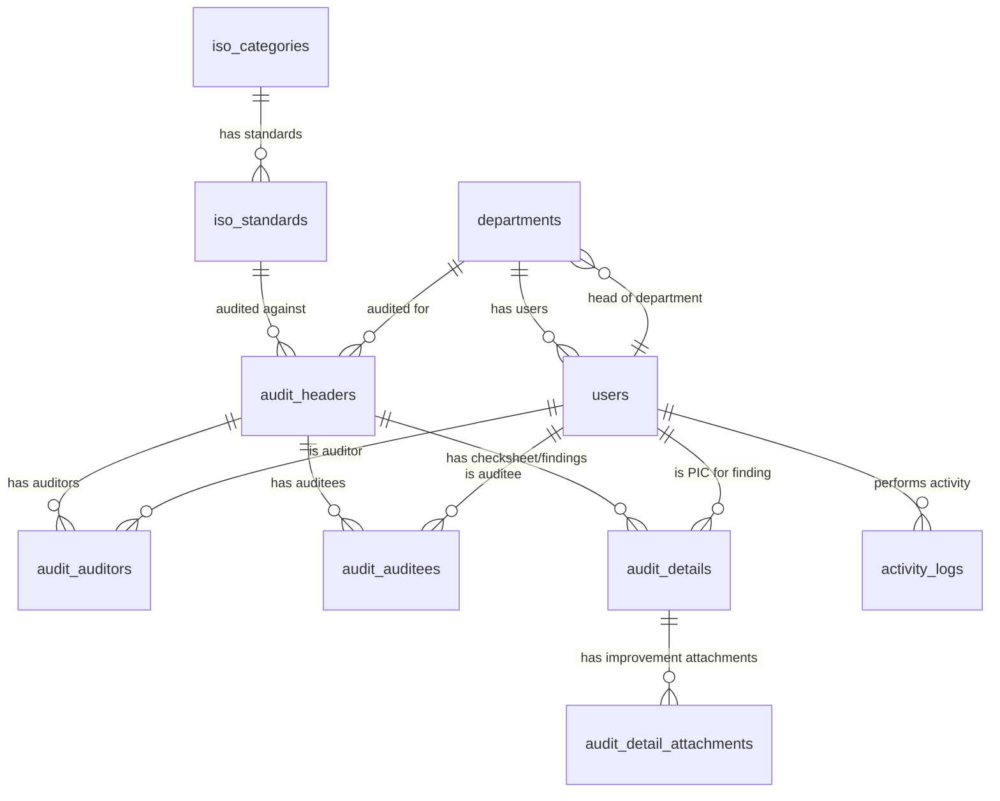

# Physical Data Model (PDM) - Internal Audit System

Berdasarkan analisis form dan komponen frontend (`ALDISFE`), saya menyusun struktur database yang sudah dinormalisasi (hingga 3NF). Desain ini mengadopsi pola tabel **Header** dan **Detail** untuk modul Audit. Setiap tabel juga sudah dilengkapi dengan 5 kolom standar: `created_by`, `created_date`, `update_by`, `update_date`, dan `is_active`.

## Entity Relationship Diagram (ERD)

---

## 1. Tabel Master (Master Data)

### `users`
Menyimpan data pengguna, level pekerjaan, role (administrator/user), dan departemen.
| Column | Type | Constraints | Description |
|---|---|---|---|
| `id` | INT / UUID | PK, Auto Increment | |
| `employee_id` | VARCHAR(50) | UNIQUE, NOT NULL | |
| `fullname` | VARCHAR(255) | NOT NULL | |
| `nickname` | VARCHAR(100) | | |
| `email` | VARCHAR(255) | UNIQUE, NOT NULL | |
| `department_id` | INT | FK ke `departments.id` | |
| `job_level` | VARCHAR(100) | | |
| `job_title` | VARCHAR(150) | | |
| `role` | VARCHAR(50) | | administrator / user |
| `created_by` | VARCHAR(100) | NOT NULL | |
| `created_date` | DATETIME | NOT NULL | |
| `update_by` | VARCHAR(100) | | |
| `update_date` | DATETIME | | |
| `is_active` | TINYINT(1) | DEFAULT 1 | |

### `departments`
| Column | Type | Constraints | Description |
|---|---|---|---|
| `id` | INT / UUID | PK, Auto Increment | |
| `code` | VARCHAR(50) | UNIQUE, NOT NULL | |
| `name` | VARCHAR(150) | NOT NULL | |
| `head_user_id` | INT / UUID | FK ke `users.id` | Dept. Head |
| `created_by` | VARCHAR(100) | NOT NULL | |
| `created_date` | DATETIME | NOT NULL | |
| `update_by` | VARCHAR(100) | | |
| `update_date` | DATETIME | | |
| `is_active` | TINYINT(1) | DEFAULT 1 | |

### `iso_categories`
| Column | Type | Constraints | Description |
|---|---|---|---|
| `id` | INT | PK, Auto Increment | |
| `name` | VARCHAR(150) | NOT NULL | cth: Quality Management |
| `created_by` | VARCHAR(100) | NOT NULL | |
| `created_date` | DATETIME | NOT NULL | |
| `update_by` | VARCHAR(100) | | |
| `update_date` | DATETIME | | |
| `is_active` | TINYINT(1) | DEFAULT 1 | |

### `iso_standards`
| Column | Type | Constraints | Description |
|---|---|---|---|
| `id` | INT | PK, Auto Increment | |
| `code` | VARCHAR(100) | NOT NULL | cth: ISO 9001 |
| `version` | VARCHAR(50) | | cth: 2015 |
| `title` | VARCHAR(255) | NOT NULL | |
| `category_id` | INT | FK ke `iso_categories.id` | |
| `effective_date` | DATE | | |
| `created_by` | VARCHAR(100) | NOT NULL | |
| `created_date` | DATETIME | NOT NULL | |
| `update_by` | VARCHAR(100) | | |
| `update_date` | DATETIME | | |
| `is_active` | TINYINT(1) | DEFAULT 1 | |

---

## 2. Tabel Transaksi (Header & Detail)

### `audit_headers` (Tabel Header Audit)
Menyimpan general information / informasi utama suatu Audit Plan. (Satu baris mewakili satu event Audit).
| Column | Type | Constraints | Description |
|---|---|---|---|
| `id` | INT / UUID | PK, Auto Increment | |
| `title` | VARCHAR(255) | NOT NULL | |
| `iso_standard_id` | INT | FK ke `iso_standards.id` | |
| `department_id` | INT / UUID | FK ke `departments.id` | |
| `audit_date` | DATE | NOT NULL | |
| `status` | VARCHAR(50) | | Not Yet Started, Open, Closed |
| `created_by` | VARCHAR(100) | NOT NULL | |
| `created_date` | DATETIME | NOT NULL | |
| `update_by` | VARCHAR(100) | | |
| `update_date` | DATETIME | | |
| `is_active` | TINYINT(1) | DEFAULT 1 | |

### `audit_auditors` (Detail - Auditor)
Many-to-many relationship (Auditors dalam sebuah audit).
| Column | Type | Constraints | Description |
|---|---|---|---|
| `id` | INT | PK, Auto Increment | |
| `audit_header_id` | INT / UUID | FK ke `audit_headers.id` | |
| `user_id` | INT / UUID | FK ke `users.id` | |
| `created_by` | VARCHAR(100) | NOT NULL | |
| `created_date` | DATETIME | NOT NULL | |
| `update_by` | VARCHAR(100) | | |
| `update_date` | DATETIME | | |
| `is_active` | TINYINT(1) | DEFAULT 1 | |

### `audit_auditees` (Detail - Auditee)
Many-to-many relationship (Auditees dalam sebuah audit).
| Column | Type | Constraints | Description |
|---|---|---|---|
| `id` | INT | PK, Auto Increment | |
| `audit_header_id` | INT / UUID | FK ke `audit_headers.id` | |
| `user_id` | INT / UUID | FK ke `users.id` | |
| `created_by` | VARCHAR(100) | NOT NULL | |
| `created_date` | DATETIME | NOT NULL | |
| `update_by` | VARCHAR(100) | | |
| `update_date` | DATETIME | | |
| `is_active` | TINYINT(1) | DEFAULT 1 | |

### `audit_details` (Tabel Detail - Checksheet / Findings)
Tabel ini digunakan oleh Auditor untuk menjawab **Checksheet**, serta digunakan oleh Auditee/PIC untuk memberikan jawaban perbaikan (**Improvement**).
| Column | Type | Constraints | Description |
|---|---|---|---|
| `id` | INT / UUID | PK, Auto Increment | |
| `audit_header_id` | INT / UUID | FK ke `audit_headers.id` | |
| `standard_reference` | VARCHAR(255) | NOT NULL | |
| `question` | TEXT | NOT NULL | |
| `objective_evidence_finding` | TEXT | | (Diisi oleh Auditor saat Fill Audit) |
| `finding_category` | VARCHAR(50) | | OK, OFI, NC Minor, NC Major |
| `area_department_process` | VARCHAR(255) | | |
| `reference_document` | VARCHAR(255) | | |
| `pic_id` | INT / UUID | FK ke `users.id` | Person-In-Charge (jika ada Temuan) |
| `due_date` | DATE | | Batas penyelesaian dari Auditor |
| `improvement_completion_date` | DATE | | (Diisi oleh PIC saat submit Improvement) |
| `improvement_cause_analysis` | TEXT | | (Diisi oleh PIC saat submit Improvement) |
| `improvement_corrective_action`| TEXT | | (Diisi oleh PIC saat submit Improvement) |
| `status` | VARCHAR(50) | | (Not Answered, In Progress, Completed, dll) |
| `created_by` | VARCHAR(100) | NOT NULL | |
| `created_date` | DATETIME | NOT NULL | |
| `update_by` | VARCHAR(100) | | |
| `update_date` | DATETIME | | |
| `is_active` | TINYINT(1) | DEFAULT 1 | |

### `audit_detail_attachments` (Detail - Bukti Perbaikan / Improvement)
Menyimpan maksimal 3 unggahan dokumen/bukti dari PIC auditee. Terhubung ke `audit_details`.
| Column | Type | Constraints | Description |
|---|---|---|---|
| `id` | INT | PK, Auto Increment | |
| `audit_detail_id` | INT / UUID | FK ke `audit_details.id` | |
| `file_name` | VARCHAR(255) | NOT NULL | |
| `file_path` | VARCHAR(255) | NOT NULL | |
| `file_size` | INT | | Size dalam Bytes |
| `file_type` | VARCHAR(100) | | MIME type (JPG/PDF dll) |
| `created_by` | VARCHAR(100) | NOT NULL | |
| `created_date` | DATETIME | NOT NULL | |
| `update_by` | VARCHAR(100) | | |
| `update_date` | DATETIME | | |
| `is_active` | TINYINT(1) | DEFAULT 1 | |

### `activity_logs` (Transaction Logs)
Tabel ini mengakomodasi page Log Activity.
| Column | Type | Constraints | Description |
|---|---|---|---|
| `id` | INT / UUID | PK, Auto Increment | |
| `user_id` | INT / UUID | FK ke `users.id` | User yang melakukan aktivitas |
| `activity` | VARCHAR(255) | NOT NULL | Aktivitas (contoh: "Create Audit Plan") |
| `log_datetime` | DATETIME | NOT NULL | Waktu kejadian log |
| `created_by` | VARCHAR(100) | NOT NULL | |
| `created_date` | DATETIME | NOT NULL | |
| `update_by` | VARCHAR(100) | | |
| `update_date` | DATETIME | | |
| `is_active` | TINYINT(1) | DEFAULT 1 | |
